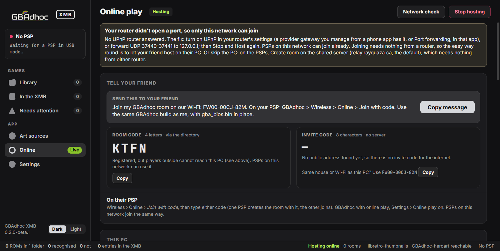

<p align="center">
  <picture>
    <source srcset="docs/img/logo-xmb-dark.png" media="(prefers-color-scheme: dark)">
    <source srcset="docs/img/logo-xmb-light.png" media="(prefers-color-scheme: light)">
    
  </picture>
</p>

<h3 align="center">Every GBA, Game Boy and Game Boy Color game its own icon in your PSP's XMB,<br>opening straight into GBAdhoc.</h3>

<p align="center">
  <a href="LICENSE"></a>
  <a href="https://github.com/ShoshinFauteux/GBAdhoc-XMB/releases"></a>
  
  
</p>

<p align="center">
  <a href="https://github.com/ShoshinFauteux/GBAdhoc-XMB/releases"><b>⬇&nbsp; Download the pre-release</b></a>
  &nbsp;&nbsp;·&nbsp;&nbsp; <a href="#how-it-works">How it works</a>
  &nbsp;&nbsp;·&nbsp;&nbsp; <a href="#install">Install</a>
  &nbsp;&nbsp;·&nbsp;&nbsp; <a href="#play-online-host-from-your-pc"><b>Play online</b></a>
  &nbsp;&nbsp;·&nbsp;&nbsp; <a href="#faq-and-troubleshooting">FAQ</a>
  &nbsp;&nbsp;·&nbsp;&nbsp; <a href="#pre-release-more-work-before-10">Known issues</a>
  &nbsp;&nbsp;·&nbsp;&nbsp; <a href="https://github.com/ShoshinFauteux/GBAdhoc">GBAdhoc</a>
</p>

<p align="center">
  
  <br>
  <sub><b>The Windows app and the PSP app</b>, in the Mono theme. Both screens captured from the real apps, on a test folder of placeholder ROMs; the PSP is a 3D render of the <a href="https://sketchfab.com/3d-models/sony-psp-dca89d10ec304d0cab76837750df7761">Sony PSP model</a> by <a href="https://sketchfab.com/strov">Ilya Ostrovsky</a>, <a href="http://creativecommons.org/licenses/by/4.0/">CC BY 4.0</a>.</sub>
</p>

**GBAdhoc XMB is a companion to [GBAdhoc](https://github.com/ShoshinFauteux/GBAdhoc),** the
GBA, Game Boy and Game Boy Color emulator for the PSP. It gives each of your games its own
entry in the XMB's Game column, with its own title, icon and background. Pick the game in the
XMB and it opens straight into GBAdhoc, with the same saves and save states as the game list.

It comes as two apps with one design. **The PSP app** does everything on the console: it
finds your ROMs, recognises them, fetches their art over Wi-Fi and makes the entries.
**The Windows app** does the same over USB, for a whole library at once.
Both come in five colour themes, chosen in Settings: **Mono**, the default, shown here,
**Graphite**, **Slate**, **Teal** and **Classic**.

**New: play online from your PC.** The Windows app can host GBAdhoc's online link play: press
*Host*, send your friend a four-letter code, and your PSPs link over the internet, directly
whenever the networks allow. See [Play online](#play-online-host-from-your-pc).

An entry is a small launcher of about 130 KB and a `launch.ini` that names the ROM. **Your
ROMs are never copied.**

> **This is a pre-release, 0.2.0 beta 1.** It works on a real PSP Go, and there is more to do
> before 1.0: see [Pre-release: more work before 1.0](#pre-release-more-work-before-10).
> Entries need **GBAdhoc 4.6.0-beta.4 or later**, which added the launch mode they start. Beta 4 is in testing and will be published on the [GBAdhoc releases page](https://github.com/ShoshinFauteux/GBAdhoc/releases) shortly; until then entries cannot start a game.

<br>

## What it does

<table>
<tr>
<td width="50%" valign="top">

<b>Your library, on the PSP</b><br>
<sub>Every ROM in GBAdhoc's <code>roms</code> folder, recognised by its No-Intro name, with a preview of its place in the XMB. L and R filter by what is in the XMB, what is not, and what needs attention.</sub>
</td>
<td width="50%" valign="top">

<b>One game, your way</b><br>
<sub>Change the title with the on-screen keyboard, pick the box art and the hero art, or use a picture from the PSP. Then <i>Make entry</i>.</sub>
</td>
</tr>
<tr>
<td width="50%" valign="top">

<b>All of them at once</b><br>
<sub><i>Make all entries</i> shows every icon before it writes, and how much space they take. Games with no art yet get a title card.</sub>
</td>
<td width="50%" valign="top">

<b>In the XMB</b><br>
<sub>The new icon, where it will be in the Game column. Quit to the XMB and it is there.</sub>
</td>
</tr>
<tr>
<td width="50%" valign="top">

<b>The Windows app</b><br>
<sub>The same design over USB. It finds the PSP by itself, shows every game as a card, and previews each entry in the XMB before it writes.</sub>
</td>
<td width="50%" valign="top">

<b>Safe to unplug</b><br>
<sub>Each entry is written to a staging folder, checked, and only then moved into place. Pull the cable mid-queue and nothing is left half-written; plug it back in and the queue resumes.</sub>
</td>
</tr>
</table>

## Play online: host from your PC

> **Experimental**, like GBAdhoc's online play itself (4.6.0-beta.4 and later).

**Link play with a friend anywhere.** Press **Host** in the Windows app's Online tab, send your
friend the four-letter code, and your PSPs link over the internet as if a cable ran between
them. The PSPs connect directly to each other whenever their networks allow it. When they can't,
your PC passes the traffic along. `relay.rayquaza.ca` is only a directory that turns the code
into your PC's address; game traffic never goes through it.

<p align="center">
  
  <br>
  <sub><b>Hosting.</b> Captured from the real app in a loopback test: the router is a simulated UPnP device, the directory runs locally, and the two players are GBAdhoc's simulated test consoles on port 37440, so the invite code is the 11-character form (8 characters on GBAdhoc's default port).</sub>
</p>

**On the PC (the host):**

1. Open GBAdhoc XMB and click **Online**, then **Host online room**. If Windows asks whether the
   app may use the network, allow it.
2. The app opens the ports on your router with UPnP and checks your connection. When it says
   **Ready: friends can join with code ABCD**, click **Copy message** and send it to your friend.
3. Keep the app open while you play. *Stop hosting* closes the room.

**On each PSP (you and your friend):** in GBAdhoc, turn on Settings › Online play. Then go to
Wireless › Online › **Join with code**, type the code and join. The first PSP in hosts the link
session, and the second follows it.

Something not working? See the [FAQ and troubleshooting](#faq-and-troubleshooting) at the end.

## Features

### PSP app

- **Runs on the console.** A standalone app in the Game column. It finds GBAdhoc on the Memory
  Stick or on a PSP Go's internal storage and scans its `roms` folder, the per-system folders
  `roms/GBA`, `roms/GB` and `roms/GBC` included, plus up to 16 folders you add.
- **Recognises your games by name** against about 9,300 names built into the app (No-Intro titles and GBAdhoc-heroart's), so
  recognition works offline. ROM hacks with their own hero art are recognised too.
- **Fetches art over Wi-Fi:** box art from libretro-thumbnails, in the region you prefer, and
  hero art from GBAdhoc-heroart, over TLS. Art is downloaded once and kept in GBAdhoc's own
  `boxart` and `hero` folders, where GBAdhoc uses it too. Art GBAdhoc already has is used first.
- **Makes, updates and removes entries**, one at a time, for the games you mark, or all at once.
  An entry whose ROM has moved is found and can be fixed with one button.
- **Composes the icon** from the hero and the box art, uses the box art alone, or draws a title
  card for a game with no art yet. Your own pictures work too.
- **Previews the XMB** for each game before it writes anything.
- **Uses the PSP's own network settings** and works offline: without Wi-Fi you can still make
  entries with the art already on the stick.
- **Five colour themes.** Mono (true mono black: layered dark greys, off-white text and a
  soft silver accent, the default), Graphite (neutral greys with an amber accent), Slate (cool
  greys, steel blue), Teal (the logo's teal) and Classic (the indigo and violet of the first
  beta). Change it in Settings › Theme with ◀ and ▶; it applies at once and is kept. A theme you
  chose before is kept; new installs start in Mono.

### Windows app

- **One exe, nothing to install.** The UI is inside it, shown by the WebView2 runtime that
  Windows 10 and 11 include. The same five colour themes as the PSP app, in Settings › Theme,
  each in dark or light.
- **Finds the PSP by itself**, whatever drive letter Windows gives it, on a PSP-1000, 2000, 3000
  or Go. A Go's Memory Stick and internal storage are both shown.
- **Recognises ROMs properly** against the No-Intro lists from libretro-database: by checksum,
  by file name or by the game code in the ROM's header. A ROM with a game's code but not its
  dump is recognised as a hack of that game.
- **Box art from libretro-thumbnails** in every region it exists in, **hero art from
  GBAdhoc-heroart**, or your own pictures, from the PSP's PICTURE folder or from the PC.
- **Make, update and remove,** one game or a whole queue, with a preview of the XMB for each.
- **Safe staged writes.** An entry is written to `<GBAdhoc>/xmb/stage/`, flushed, read back and
  only then moved into `PSP/GAME` in one rename. After an unplug, the next scan finishes or
  undoes what was interrupted, and the queue resumes at the game it stopped on.
- **Hosts GBAdhoc online play** (experimental): the Online tab runs GBAdhoc's relay on this
  PC, opens its ports with UPnP while you host, and shows the rooms, the players and their
  ping. See [Play online](#play-online-host-from-your-pc).
- **Light on the network.** Lists and art are cached in `%LOCALAPPDATA%\GBAdhoc XMB`, GitHub is
  asked a few times a week, and when GitHub rate-limits, thumbnails.libretro.com is used
  instead.

## How it works

An entry is a folder in `PSP/GAME` that looks like any other game to the XMB:

```
PSP/GAME/XMB_Pokemon_Emerald/
├── EBOOT.PBP     about 130 KB: the launcher, with this game's title, ICON0 and PIC1
└── launch.ini    which ROM to start, and where GBAdhoc is
```

```ini
rom = Pokemon - Emerald Version (USA, Europe).gba
gbadhoc = PSP/GAME/GBAdhoc
```

- **Every entry has the same launcher code.** Only its title, its icon (ICON0, 144x80), its
  background (PIC1, 480x272) and its `launch.ini` differ.
- **The launcher starts your installed GBAdhoc** in its launch mode, with the ROM from
  `launch.ini`. Updating GBAdhoc updates every entry.
- **The theme is only the app's.** The one piece of an entry it reaches is the title card, the
  icon a game with no art gets: its Game Boy Advance cards are drawn in the theme's colour
  family (Game Boy and Game Boy Color cards look the same in every theme). An entry keeps the
  icon it was written with; changing the theme only changes entries made or updated after.
  Box art, hero art, your own pictures and the launcher are the same in every theme.
- **No ROM is copied.** The ROM stays in GBAdhoc's `roms` folder, so an entry is never a copy
  of a game. Saves, save states, settings and cheats are the game list's own: a game is the
  same game from its entry or from the list.
- *Exit* in the game goes back to the XMB, and *Quit to game list* opens GBAdhoc's list. If the
  ROM or GBAdhoc is missing, the launcher says so on screen, with the path it looked for.
- An entry on a PSP Go's internal storage can start a GBAdhoc on the Memory Stick, and the
  other way round.

Both apps write entries with the same code (`shared/xw_core.c`), so an entry is the same
whichever app made it. The full contract is in [docs/XMB-LAUNCH.md](docs/XMB-LAUNCH.md).

## Install

First, install **GBAdhoc 4.6.0-beta.4 or later** in `PSP/GAME/GBAdhoc`, with your ROMs in its
`roms` folder. Then use either app, or both.

### PSP app

1. Download `GBAdhoc-XMB-0.2.0-beta.1-psp.zip` from the
   [pre-release](https://github.com/ShoshinFauteux/GBAdhoc-XMB/releases) and unzip it to the
   **root** of your Memory Stick or your PSP Go's internal storage. It lands in
   `PSP/GAME/GBAdhocXMB`.
2. Start **GBAdhoc XMB** from the Game column. It finds GBAdhoc and scans your ROMs.
3. Open a game with ✕, choose *Get art from the internet* if you are online, then *Make entry*.
   Or press △ for the library actions and choose *Make all entries*.
4. Quit with HOME. Your games are in the Game column.

### Windows app

1. Download `GBAdhoc-XMB-0.2.0-beta.1-windows.zip` from the
   [pre-release](https://github.com/ShoshinFauteux/GBAdhoc-XMB/releases) and unzip it anywhere.
2. Connect the PSP in USB mode (on a Go, Settings › USB Connection) and run
   `GBAdhoc-XMB.exe`. It finds the PSP and scans it.
3. Click a game for its entry, or use *Make all entries*. When the app says *Done*, leave USB
   mode. The entries are in the Game column.

The exe is not signed yet, so Windows SmartScreen may say *Windows protected your PC*. Click
**More info**, then **Run anyway**.

To undo everything, use *Remove entry* in either app, or delete the entry folders in `PSP/GAME`
(each one holds a `launch.ini`; the Windows app names them `XMB_<title>`).
ROMs, saves and GBAdhoc are never touched.

## Requirements

- **GBAdhoc 4.6.0-beta.4 or later.** Entries start GBAdhoc's launch mode, which earlier versions
  do not have.
- **A PSP running custom firmware.** Developed and tested on ARK-4. PSP-1000, 2000, 3000 and Go.
- **For art over Wi-Fi on the PSP:** a 2.4 GHz network. For WPA2 networks, ARK-4 with its WPA2
  plugin. Without Wi-Fi the PSP app still makes entries, with the art already on the stick or
  a title card.
- **For the Windows app:** Windows 10 or 11 with the WebView2 runtime, which both include. The
  app explains what to do if it is missing.

## Pre-release: more work before 1.0

GBAdhoc XMB has been tested on a real PSP Go, where it works. This is what we know is left:

- **The line through the logo on the PSP app's start screen:** fixed, awaiting confirmation on
  hardware.
- **A PSP Go's internal storage and the network dialog** have only been lightly tested on real
  hardware. Reports from a Go are welcome.
- **The Windows exe is unsigned**, so SmartScreen warns about it the first time.
- **A ROM hack's match confidence is fixed** rather than measured, so a hack's score does not
  yet say how close it is to its base game.
- **Online hosting is experimental.** Its tests run on loopback against a simulated router and
  simulated consoles; the first sessions with real PSPs over the internet found the problems
  listed in the [FAQ](#faq-and-troubleshooting). Reports are welcome, with the
  Online tab's log.
- **More art sources.** Today box art comes from libretro-thumbnails and hero art from
  GBAdhoc-heroart only.

Found something else? Open an [issue](https://github.com/ShoshinFauteux/GBAdhoc-XMB/issues)
with your PSP model, and for the PSP app, `PSP/GAME/GBAdhocXMB/log/xmbapp.log`; for the Windows
app, `%LOCALAPPDATA%\GBAdhoc XMB\log.txt`.

## Building from source

Docker supplies both toolchains: `pspdev/pspdev` for the PSP, and a small Debian image with
mingw-w64 for Windows (`desktop/Dockerfile`, built on first use).

```bash
./build.sh            # the launcher, the PSP app and the Windows app
./build.sh psp        # launcher/EBOOT.PBP and psp/EBOOT.PBP
./build.sh desktop    # launcher/EBOOT.PBP and desktop/dist/GBAdhoc-XMB.exe
```

It runs from Git Bash on Windows or from Linux and WSL. Each part also builds on its own; the
command is at the top of `launcher/Makefile`, `psp/Makefile` and `desktop/build.sh`.

Tests:

```bash
tools/test_core.sh        # Linux/WSL: entries checked byte by byte, PARAM.SFO against the SDK's mksfoex
desktop/test_app.sh       # Windows: the real app on fake PSPs, offline, cable pulls included
desktop/tests/online/test_online.sh  # Windows: online hosting, loopback only (relay core NAT model and
                                     # fuzz, UPnP vs a fake router, start/stop x50, two simulated consoles,
                                     # and the real app's Online tab)
psp/tools/run_ppsspp.sh   # Linux/WSL: the PSP app in PPSSPP, driven by a key script
python tools/test_themes.py                  # every theme defines every token, in both apps
python psp/tools/check_shots.py <shots dir>  # contrast, size and overlap of the text in those shots
```

The test folders hold placeholder ROMs only: correct headers and names, no game.

| Folder | What is in it |
|---|---|
| `launcher/` | The per-game launcher every entry carries |
| `psp/` | The PSP app. `psp/gen/` holds generated headers (fonts, art, the name list, the launcher), committed; `psp/tools/` regenerates them |
| `desktop/` | The Windows app: the C host, the WebView2 bridge and the UI in `desktop/ui/` |
| `shared/` | The entry writer and the No-Intro matcher both apps build; `shared/relay/`, GBAdhoc's online relay core ([provenance and licence](shared/relay/README.md)) |
| `tools/` | The command-line maker, the entry checker and the core test |
| `docs/` | [The entry contract](docs/XMB-LAUNCH.md) and [the shared core](docs/SHARED-CORE.md) |

## Credits

- **[GBAdhoc](https://github.com/ShoshinFauteux/GBAdhoc)**, the emulator these entries start.
  Its launch mode is what makes an entry possible.
- **[libretro-thumbnails](https://github.com/libretro-thumbnails)**, where the box art comes
  from, and **[libretro-database](https://github.com/libretro/libretro-database)**, for the
  No-Intro lists the Windows app recognises ROMs with.
- **[GBAdhoc-heroart](https://github.com/ShoshinFauteux/GBAdhoc-heroart)**, the hero art.
- **No-Intro**, whose naming every lookup is built on.
- **Mbed TLS**, for https:// on the PSP; **stb_image** by Sean Barrett, for decoding and encoding
  art; **Inter** by Rasmus Andersson and **JetBrains Mono**, the typefaces; **PSPSDK / pspdev**
  and **psp-cfw-sdk**, the PSP toolchain.
- **ShoshinFauteux**, project lead: chose the design, and tested on a real PSP Go.

Full third-party notices: [THIRD_PARTY.md](THIRD_PARTY.md).

## Licence

GPL-2.0-or-later, the same as GBAdhoc. See [LICENSE](LICENSE) and [NOTICE](NOTICE).

GBAdhoc XMB contains no games, BIOS files or game artwork. PSP and XMB are trademarks of Sony
Interactive Entertainment, and Game Boy is a trademark of Nintendo; this project is not
affiliated with either.

## FAQ and troubleshooting

Online play from the Windows app. These are the problems found in the first real sessions.

#### My friend's PSP says "server did not answer"

The PSP could not reach your PC. Check these in order:
- The Online tab says **Ready**.
- Windows Firewall allows GBAdhoc XMB (Windows Security › Firewall & network protection › Allow an
  app through firewall).
- The code is typed exactly.

If it still fails, send the **invite code** instead: it needs no server. A friend in your house
should use the same-house code (see below).

#### I'm using my phone's hotspot and it won't connect

Turn the phone's **Wi-Fi off**. When a phone is also connected to Wi-Fi, many phones (Samsung and
others) share that Wi-Fi instead of mobile data.

#### The games fell out of step (desynced)

Both players need **the same GBAdhoc build** and **`gba_bios.bin`** in GBAdhoc's folder. That
includes a player in PPSSPP, which needs the BIOS file too.

#### Hosting says my router blocks it

<p align="center">
  
</p>

The app says *Your router didn't open a port, so only this network can join*. To fix it:
1. Turn on **UPnP** in your router's settings. Some provider gateways are managed only from a
   phone app: look there for UPnP or **Port forwarding**. You can also forward UDP 27420-27421 to
   your PC by hand.
2. Press **Stop**, then **Host** again.

If your router has neither setting, or the app says carrier-grade NAT or a second router, **let
your friend host instead**. Joining needs nothing from a router.

#### It works, but the player list says "Via host", not "Direct"

That is fine. The two networks would not let the PSPs reach each other directly, so your PC
passes the traffic along: the owner chose this as the fallback. It adds a little ping. Phone
networks and some routers cause it, and nothing needs fixing.

#### We're in the same house as the PC and can't connect

Many routers do not loop their own public address back into the house. The **room code**
handles this by itself: the directory sends a PSP in your house to the PC's local address. With
an **invite code**, use the **same-house** code shown under it in the Online tab.

#### Can a PSP host instead of a PC?

Yes, with GBAdhoc's own *Create room*, but the PSP's router must forward **UDP 27500** to that
PSP. Letting a PC host is easier, because GBAdhoc XMB opens its own ports.

#### It says the port is already in use

A GBAdhoc relay is already running on this PC: the standalone `gbadhoc-relay`, or another copy of
the app. The app never starts a second relay on the same port or stops the first one. It offers
**Use it**, with that relay's invite code, or to host on the next free port.

#### Does my IP address get shared?

With the person you invite, yes. A friend on the internet connects to your PC, so they learn its
public IP, and the invite code contains it. The app keeps the address hidden on screen until you
click *Show*, and *Copy message* never includes it. The room code does not contain it, though
the directory gives it to whoever looks the code up. Share codes only with people you would
tell your address.

#### Do codes expire?

No. A room code lasts while you host. An invite code stays valid while your PC keeps its public
address and port.

#### Does the PC have to stay on?

Yes. The room lasts while the app is open and hosting, and the app keeps the PC from sleeping
meanwhile. Settings › *Host when GBAdhoc XMB starts* (off by default) opens the room as soon as
the app opens.

#### Is it safe to open a port?

The ports are open only while you host, and *Stop* removes them from the router. Only link
traffic passes through your PC, never game files. The relay is GBAdhoc's own server code
(`shared/relay/`), with the same protections as the public server:
- a cookie challenge before any room is made;
- no reply larger than its request;
- per-address and per-player limits;
- rooms that expire;
- fixed-size tables.

The app never changes Windows Firewall, and it only follows a UPnP answer to an address on your
own network.

#### How many players, and what are the limits?

One room per PC, up to five players. The app's check confirms your public address but cannot
test traffic arriving from outside. Only UPnP-IGD is tried, not NAT-PMP or PCP. On *Stop* the
code is removed from the directory at once. After a crash it stays listed for 3 minutes.
